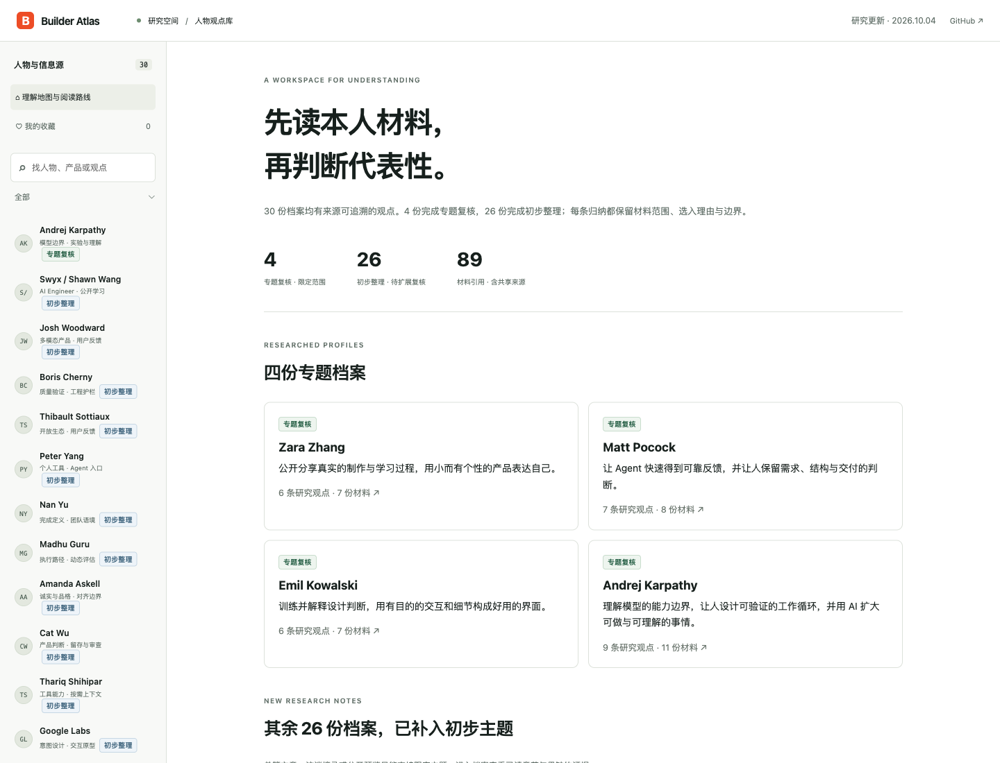

<p align="right"><a href="README.md">中文</a></p>

<p align="center">
  
</p>

<p align="center">
  <a href="https://builder-atlas.xiaosang.cc/">▶ Read Online</a>
  ·
  <a href="https://github.com/holynova/builder-atlas">GitHub Repository</a>
</p>

A source-bound reading atlas for 30 AI builders (28 people + 2 official accounts): every claim traces back to the builder's own material. Follow reading routes, check sources, and keep bookmarks and practice notes locally. The rule is "read the person's own work first, then judge how representative it is." Research snapshot: 2026-10-04.

## Screenshot

<p align="center">
  
</p>

## Contents

| Content | Count | Notes |
|---|---|---|
| Builder profiles | 30 | 28 people + 2 official accounts (Google Labs, etc.) |
| Sourced ideas | 102 | Each bound to its source and reading scope |
| Cited works | 89 | Articles, interviews, and team materials, attributed separately |
| Reading routes | 6 | Themes such as building in public, agent-checkable work, and feedback channels |
| Question & exercise sets | 30 | One per profile, with local note-taking |
| Concise paraphrases | 30 | One per profile |
| X insights | 30 profiles | Sampled 2026-10-03, target 100 timeline posts per profile |

**Status**: 4 profiles fully reviewed (Zara Zhang, Matt Pocock, Emil Kowalski, Andrej Karpathy); 26 are preliminary drafts. Tags cover only the listed material; the atlas does not claim to exhaust any author's views, nor has it re-sampled each account's latest 100 X posts. Old drafts are kept for traceability.

**Categories**: Agent 与模型 agents & models (9), 产品与设计 product & design (7), 学习与创作 learning & creation (4), 软件与创业 software & startups (3), 产业与判断 industry & judgment (3), 企业与组织 companies & organizations (2), 官方信息源 official sources (2).

## Features

- **Search**: full-text search by person, product, or idea.
- **Reading routes**: 6 thematic routes that string ideas from different builders together.
- **Idea maps**: each profile's idea structure, with clickable related ideas and source-linked explanations.
- **Local bookmarks & notes**: bookmark ideas and write practice notes — data stays in the local browser only.
- **Source disclosure**: every summary keeps its source scope, selection rationale, and limits; editorial exercises are labeled separately from the author's own claims.

## Start Here

Search for a builder or pick a reading route, open the source behind an idea, and record your own understanding with local bookmarks and practice notes. Start with the 4 fully reviewed profiles, then expand to the 26 preliminary ones by interest.

## Run Locally & Maintain

```bash
npm ci
npm run dev          # open http://localhost:8765/
# after editing data
npm run sync:data    # research/ → dist/*.json
npm run check        # verify JS and research data agree
```

Data lives in `dist/research.json`, `dist/learning.json`, and `dist/x-insights.json`; maintenance notes live in `research/` (one per person). Original texts remain copyright of their authors.

## Tech

- Plain HTML + CSS + JS, zero frameworks, zero build step; editorial paper-and-ink design (paper `#f8f9f6`, ink `#17201d`, orange annotations `#ed4d26`).
- Below 700px the index collapses into a menu; keyboard navigation switches content instantly; reduced-motion preferences are respected.

```
dist/index.html         Entry
dist/app.js             App logic: search / routes / bookmarks / notes
dist/data.js            Profile data (generated from research.json)
dist/learning.js        Reading routes, question exercises, concise paraphrases
dist/x-insights.js      X timeline insights
dist/style.css          Editorial styles
research/*.md           30 maintenance notes (one per person)
scripts/sync-data.cjs   research/ → dist data sync
scripts/check-research.cjs  Research-data consistency check
```
