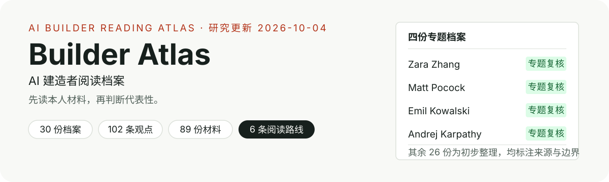
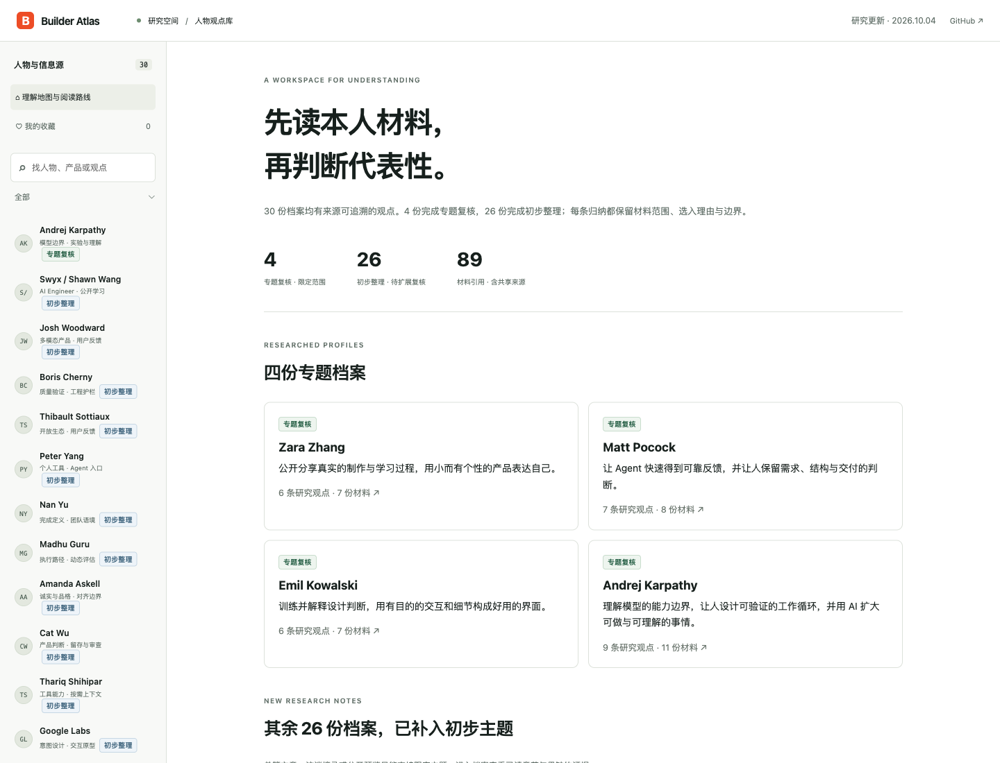

<p align="center">
  
</p>

<p align="center">
  <a href="https://builder-atlas.xiaosang.cc/">▶ 在线阅读 Read Online</a>
  ·
  <a href="https://github.com/holynova/builder-atlas">GitHub 仓库</a>
</p>

AI 建造者阅读档案：30 份来源绑定的建造者档案（28 位人物 + 2 个官方账号），每条观点都可追溯到本人材料。按阅读路线查看观点、出处、收藏和练习笔记；先读本人材料，再判断代表性。研究快照：2026-10-04。

A source-bound reading atlas for 30 AI builders (28 people + 2 official accounts): every claim traces back to the builder's own material. Follow reading routes, check sources, and keep bookmarks and practice notes locally. Research snapshot: 2026-10-04.

## 截图 / Screenshots

<p align="center">
  
</p>

## 内容 / Contents

| 内容 | 数量 | 说明 |
|---|---|---|
| 建造者档案 | 30 份 | 28 位人物 + 2 个官方账号（Google Labs 等） |
| 研究观点 | 102 条 | 每条绑定出处与阅读范围 |
| 引用材料 | 89 份 | 文章、访谈与团队材料分别归属 |
| 阅读路线 | 6 条 | 公开制作、Agent 可检查、反馈入口等主题 |
| 提问与练习 | 30 组 | 每份档案一组，可本地做笔记 |
| 精简转述 | 30 条 | 每份档案一条 |
| X 洞察 | 30 份档案 | 2026-10-03 采集，目标每人 100 条时间线样本 |

**整理状态**：4 份完成专题复核（Zara Zhang、Matt Pocock、Emil Kowalski、Andrej Karpathy），26 份为初步整理。标签只针对列出的材料；未穷尽作者观点，也未重新采集每个账号最新 100 条 X。旧稿保留供追溯。

**分类**：Agent 与模型（9）、产品与设计（7）、学习与创作（4）、软件与创业（3）、产业与判断（3）、企业与组织（2）、官方信息源（2）。

## 功能 / Features

- **搜索**：按人物、产品或观点全文搜索。
- **阅读路线**：6 条主题路线，把不同建造者的观点串起来读。
- **理解地图**：每份档案的观点结构图，可点选关联想法、查看出处解释。
- **本地收藏与笔记**：收藏观点、写练习笔记，数据只存在本地浏览器。
- **来源披露**：每条归纳都保留材料范围、选入理由与边界；编辑练习与作者原 claim 分开标注。

## 从一篇材料开始 / Start Here

搜索一位建造者或选择一条阅读路线，打开观点条目的出处，再用本地收藏和练习笔记记录自己的理解。建议先读 4 份专题复核档案，再按兴趣扩展到 26 份初步整理。

## 本地运行与维护 / Run Locally

```bash
npm ci
npm run dev          # 打开 http://localhost:8765/
# 修改数据后
npm run sync:data    # research/ → dist/*.json
npm run check        # 校验 JS 与研究数据一致性
```

数据位于 `dist/research.json`、`dist/learning.json` 和 `dist/x-insights.json`，维护记录位于 `research/`（每人一篇）。原文版权属于各作者。

## 技术 / Tech

- 纯 HTML + CSS + JS，零框架、零构建；编辑纸面风（纸面 `#f8f9f6`、墨色 `#17201d`、橙色批注 `#ed4d26`）。
- 移动端 700px 以下索引收进菜单；键盘导航即时切换内容；支持减动效偏好。

```
dist/index.html         入口
dist/app.js             应用逻辑：搜索 / 路线 / 收藏 / 笔记
dist/data.js            档案数据（由 research.json 生成）
dist/learning.js        阅读路线、提问练习、精简转述
dist/x-insights.js      X 时间线洞察
dist/style.css          编辑风样式
research/*.md           30 份维护记录（每人一篇）
scripts/sync-data.cjs   research/ → dist 数据同步
scripts/check-research.cjs  研究数据一致性校验
```

## English

**Builder Atlas** — a source-bound reading workbench for 30 AI builders (28 people + 2 official accounts). Every claim traces to the builder's own material; the rule is "read the person's own work first, then judge how representative it is."

- **Contents**: 30 profiles, 102 sourced ideas, 89 cited works, 6 reading routes, 30 question-and-exercise sets, 30 concise paraphrases, X insights sampled 2026-10-03 (target: 100 timeline posts per profile). Snapshot: 2026-10-04.
- **Status**: 4 profiles fully reviewed (Zara Zhang, Matt Pocock, Emil Kowalski, Andrej Karpathy); 26 are preliminary drafts — each marked with its source scope, selection rationale, and limits. Tags cover only the listed material; the atlas does not claim to exhaust any author's views.
- **Features**: full-text search, 6 thematic reading routes, per-profile idea maps with source-linked explanations, local-only bookmarks and practice notes.
- **Run it**: `npm ci && npm run dev` (http://localhost:8765/). Data lives in `dist/*.json`, maintained from `research/*.md` via `npm run sync:data`.
- **Tech**: plain HTML + CSS + JS, zero frameworks, zero build step. Editorial paper-and-ink design.
